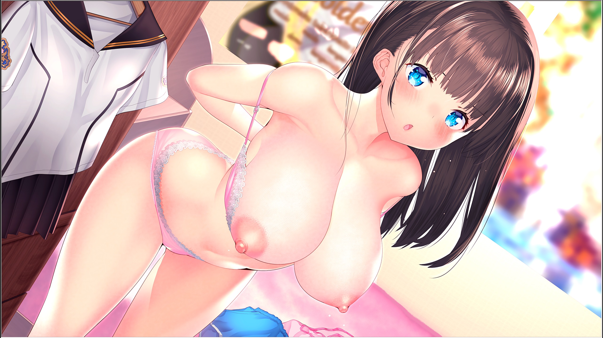
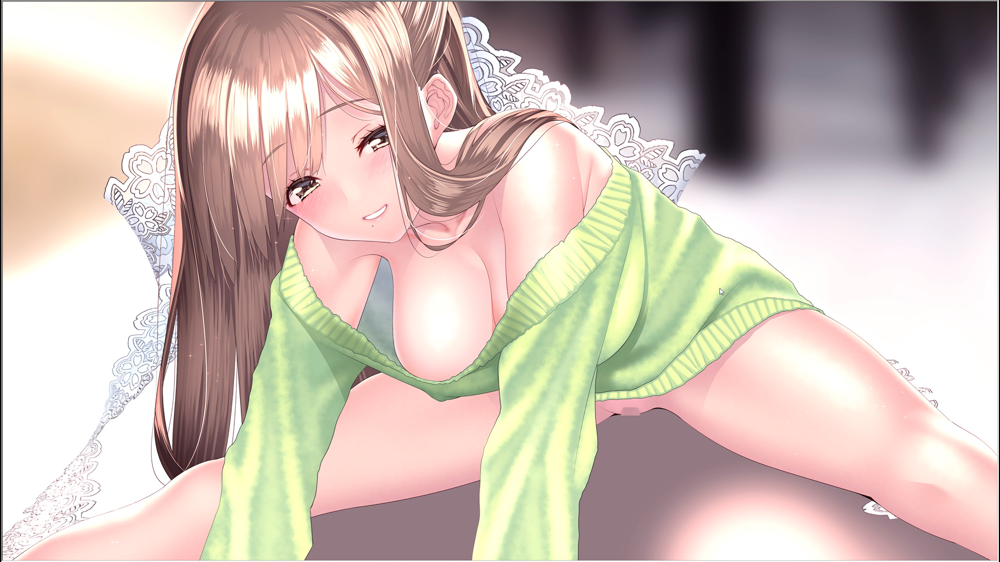
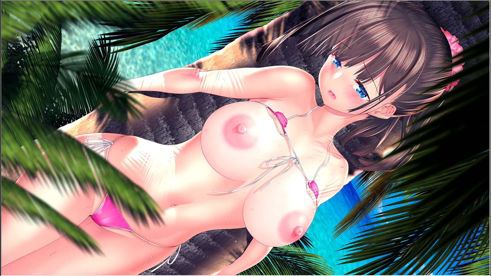
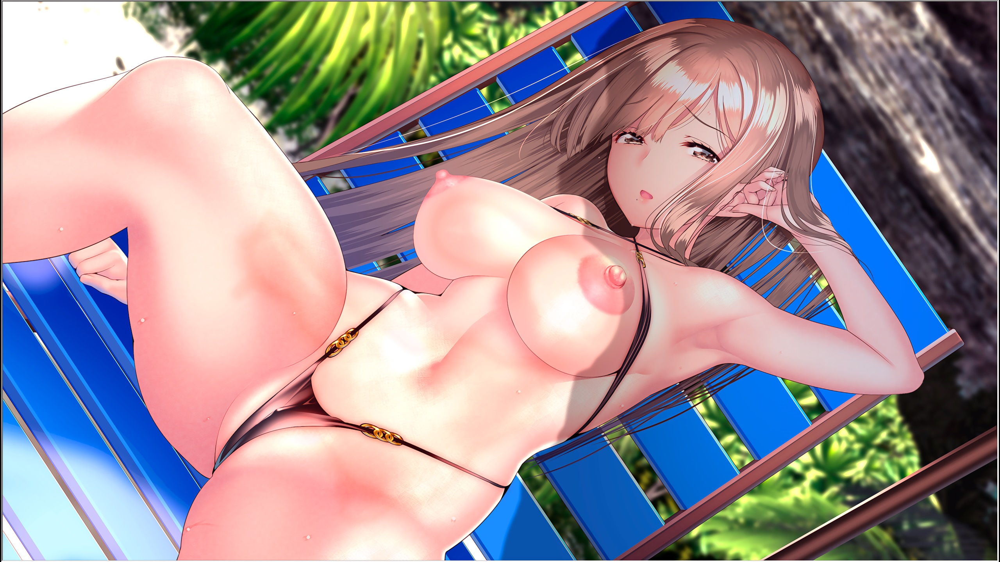
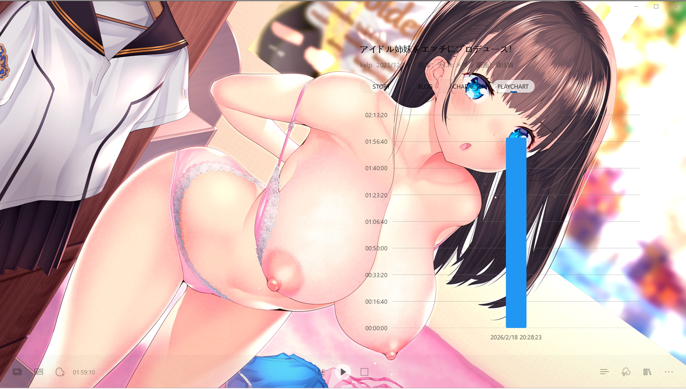
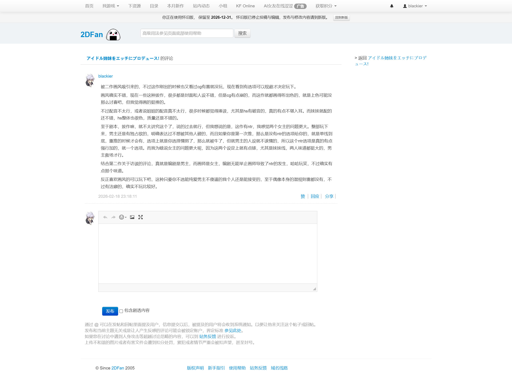

> 更新日志：
>
> 2026年11月27日17:12:28，整理完。 
> 新章，第八篇，发布于2dfan。 
> 这是26年的第一篇，那段时期我记得应该已经把老房子的墙砌的差不多了，在考虑怎么盖屋顶，还有伐树的事情吧，反正是忙活到四月份才最终把老屋盖好。 
> 作品本身就没啥了，就是个拔作，就像我说的，有牛我是不会玩的，只有这种画风好，还能规避的我才会碰。 
> 否则多好我都不会玩，我现在倒是对处不处女没那么较真了，我记得说过吧，应该是大学期间，我看ehview的时候，对非处还是很抵触的，看到不是直接就返回了。 
> 到后面不知不觉，不知道什么时候开始就觉得没那么抵触了，觉得以前别玩得那么花，之后只爱男主的我都差不多能接受。 
> 这就是多少xp被改变了吧，或者说还是被色欲影响了，但多少也有点很多情况下，一些非处不是自愿发生或者被骗的，就有点可怜的那种。 
> 我其实对女孩子很怜惜的，我记得高中时，看到过一个新闻，是说日本一个初中女孩因为某些缘由，不得不去拍av。 
> 我当时就觉得很难受，为什么会有这种样事情发生呢？很想自己如果有能力去拯救就好了。 
> 但可想而知，到现在只剩下个被现实打败的自己而已。 
> 好像称为一个勇者啊，当很清楚自己不可能成为一个勇者，身在黑暗里的自己，只能仰望他的光芒，驱散自己的阴暗。 
> 人是真的很复杂，今天看到b站一个讲托翁生平经历的视频，里面讲的很多内容真的能和我想到的很多道理是相同的，所以还是那句话。 
> 道理，前人早就讲完了，但世人依然不停地在犯错，就此不断循环。 
> 我昨晚把兰斯的那个动态删了，因为老是还会想我的评论内容，和别人的回复。 
> 太耗我心神了，明明很多都想通了，但是老是在脑子里浮现，让我玩gal都玩得不舒服，索性就想删掉了。 
> 删的时候，还想着要不要截图，但想着截图也只会徒留尾巴，犹接着冲劲就一下删掉了。 
> 心里突然畅快不少。 
> 这算是权衡利弊后，我的选择吧。 
> 这种删除很少发生，我记得很久之前只有qq的动态我主动删过，就为了忘记过往的一些糟心或者羞耻的事情。 
> 结果后悔了，因为那些在现在看来，没什么大不了的，算是宝贵的经历与回忆。 
> 也许这次在后面来看，也会是个不好选择？但多少有这个博客记录，我觉得差不多记到这种程度，就可以了。 
> 有个模糊印象，对我来说更好些。 
> 至此，炒股预测、esj辱骂小女孩和兰斯这三个都算是没有当时的记录了吧。 
> 我真是被这三个搞得心情很差过，以至于我已经觉得不在说些什么这种可能与别人争吵的话了，因为最后无聊对错，我都得付出很多精力，并不好受。 
> 所以那就一开始就别发就好了。 
> 兰斯那个也是，我后面也想了很多，思考过自身，别人，还有作品本身的发售环境，最终即便得出什么结论，那也只能安慰自己，思想上获得了什么成长之类的。 
> 但事实上是，我更愿意是个那个没有这件事之前的自己，心情反而可能会更好些。 
> 知道的越多，思考的越多，痛苦并不会减少，还有可能会增加。 
> 但我停止不下里，我的脑子根本停止不下来一些思考，而且往往还是往坏的方向的思考。 
> 尽管我也有往好的有趣的方向想，但心里总会不觉去联想些坏的，这也是我说让人别玩兰斯的原因，这会让人面对本来一些美好的事情而去联想一些坏的内容。 
> 这对一些健康的人来说，这无疑是种污染、毒药。 
> 我还是希望本来能过好的人，那就好好活着就好了，没必要被这些拖下水。 
> 少点这种阴湿的人，多点思想健康的，那我看着也开心。 
> 我很早前就发现，印象里是苍彼吧，是的，我更喜欢明日香那种人，是能把我拉起来的，而不是一同堕落的。 
> 而之前，我也对一同堕落很向往，但应该是后面我发现这其实只能带给我一时的快感，而我心里所向往的，依然是光明。 
> 但我做不到，我从初中开始，就尝试过戒掉手淫，一直不断尝试，失败，尝试，失败，到大学时候我发现，没救了，我就是个如此好色的人，我根本没法戒掉。 
> 自那以后，我就没想过戒掉，而是尝试去规划，但结果是，规划也很难做到。 
> 是因为生活不如意么？可能吧，可能在初中时，我的人生其实就已经埋下了祸根，然后一步步变成如此的模样。 
> 我希望，未来的孩子能有个好的环境成长，能健康的成长，不用忍受这类痛苦，更不要出现我这种人。 
> 一路爬上来，是真的很痛苦，如果当时有个好的环境，可能会有个不一样的自己。 
> 命如此，哈哈，我之前不是说过了么，我放弃了，我认命了，现在也一样。 
> 人只会成为自己该成为的样子？这是最近在二狗视频下看到的。 
> 殊途同归，条条大路通罗马，很多道理啊，都一样，人依然还是知道也继续犯错。 
> 就没啥了，就说点自己最近想说吧。 
> 后续，整理完2dfan的内容，以后应该就很少会再发推完感想了吧，大概不怎么有剧情的，可能就在blog里写写就了解了。 
> 大概吧，但我感觉我的分享欲，到时候会盖过这点忧虑。 
> 就这样，下篇再说吧。

### 2026-02-18 23:18:11 2dfan

被二作画风吸引来的，不过这作刚出的时候也又看过cg有雷就没玩，现在看到有选项可以规避才决定玩下。

画风确实不错，现在一些这种拔作，很多都是封面和人设不错，但是cg有点崩的，而这作就都画得听出色的，就是上色可能没那么讨喜吧，但我觉得画的挺棒的。

不过配音不太行，或者说姐姐的配音真不太行，很多时候都觉得捧读，尤其是hs有破音的，真的有点不堪入耳。而妹妹就配的还不错，hs整体也很色，质量还是不错的。

至于剧本，拔作嘛，就不太讲究这个了，说的过去就行，但我想说的是，这作有ntr，我感觉两个女主的问题更大。整部玩下来，男主还是有独占欲的，明确表达过不想被其他人碰的，而且如果你是第一次推，那么是没有ntr的选项给你的，就是单线到底，重推的时候才会有，选项上就是你选择懦弱了，那么就被牛了，但就男主的人设就不该懦的，所以这个ntr选项是真的有点强行加的，就一个选项。而我为啥说女主的问题更大呢，因为这两个设定上就有点婊，尤其是妹妹线，两人味道都挺大的，男主救场才行。

结合第二作关于访谈的评论，真就是编剧是男主，而画师是女主，编剧无能举止画师导致了ntr的发生，哈哈玩笑，不过确实有点那个味道。

反正喜欢画风的可以玩下吧，这种只要你不选能纯爱男主不傻逼的我个人还是能接受的，至于偶像本身的潜规则雷都没有，不过有洁癖的，确实不玩比较好。

--

